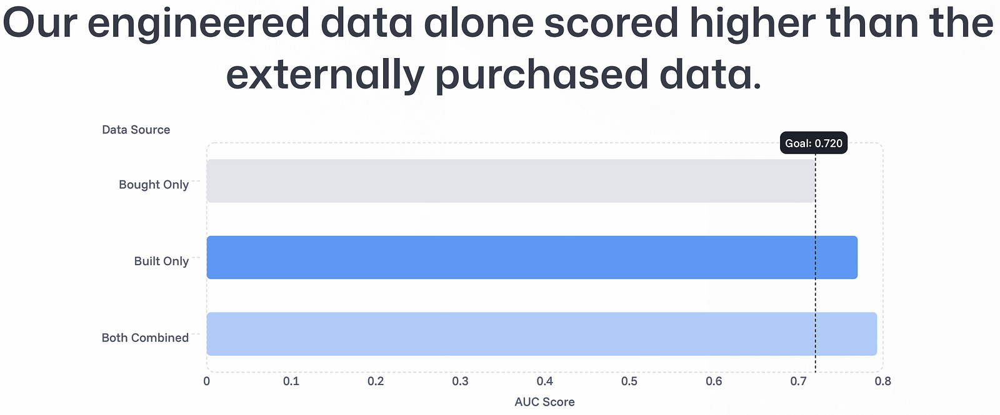
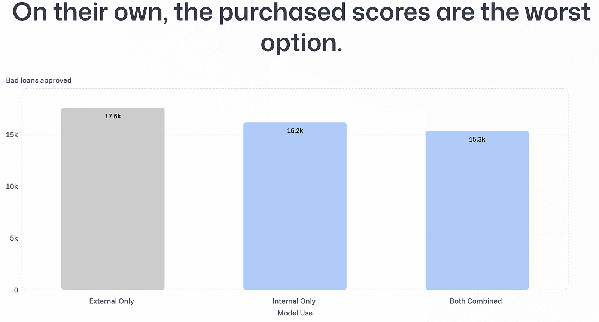
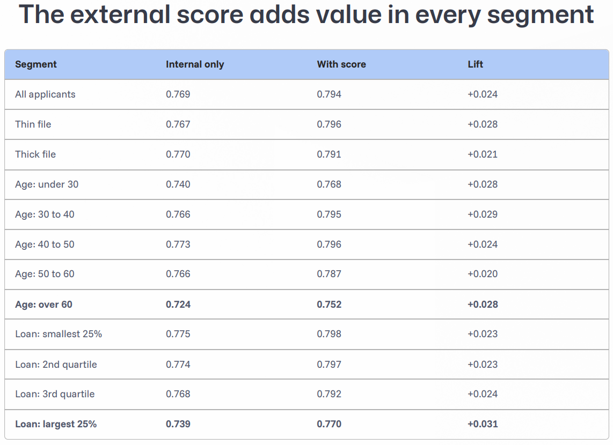
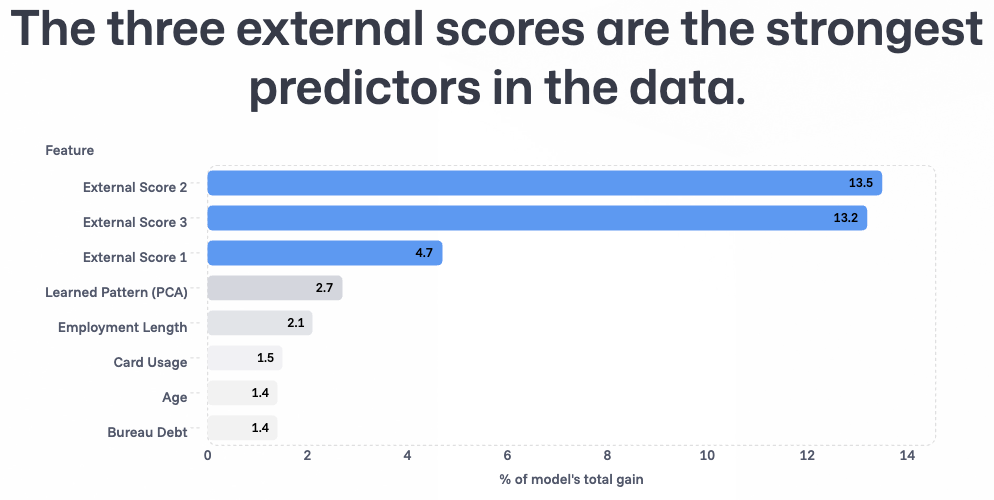

# Bought or Built?
### Home Credit already owns most of the signal needed for default prediction, so why are the external scores still worth buying?
*MSDS 696 · Practicum II · Home Credit Default Risk*

Every time someone applies for a loan, the lender quietly pays a credit bureau for a risk score, for every applicant, as a recurring fee, forever. The scores genuinely help predict default, but "it works" and "it is worth what we pay" are not the same thing. This project holds one model fixed, changes only the data it sees, and measures how much of a credit model's power actually comes from the purchased scores versus the data the lender already owns. The short answer: most of it is already owned, and yet the scores are still worth buying, everywhere.

## The question

The Home Credit dataset ships three `EXT_SOURCE` columns, documented as normalized scores from an external source, the kind of third-party rating a lender pays to obtain. Everything else is data the lender already owns. Every claim below is a measured difference in out-of-fold AUC, with the model held fixed and only the data changed:

- How much of a default model's power comes from the purchased scores versus features engineered in-house?
- How much of that gap can feature engineering close without paying?
- Where do the purchased scores stay irreplaceable, and are they worth their price?

## Headline results

| Data the model sees | OOF AUC |
| --- | --- |
| Purchased scores only (bought) | 0.720 |
| Engineered internal features only (built) | 0.769 |
| Both combined | 0.794 |

- **Built beats bought.** Features engineered from the lender's own data out-predict the three purchased scores on their own, 0.769 against 0.720. Most of a credit model's power is already in-house.
- **But the scores carry a unique sliver.** Combined AUC reaches 0.794, and only about a fifth to about half of each score can be rebuilt from internal data, so a stubborn slice is genuinely external and worth paying for.
- **The lift is real money, and worth buying everywhere.** Replayed through the approve/decline decision, the scores prevent about 850 defaults on the book, worth roughly 951 CU per applicant (about 0.16% of loan value) at a 60% loss-given-default, far above what a bureau score costs. The lift stays positive in every segment, so the call is buy for everyone, not ration.
- **It helps most where the bank is weakest.** The score adds the most on the largest loans (where a default costs the most) and the thinnest files, and the least on the well-documented middle.
- **Kaggle public leaderboard: 0.79890 AUC**, in range of the winning solutions (~0.806).



Trained on the three purchased scores alone, the model is the weakest of the three: at the same 90% approval rate it lets through the most bad loans. Internal data alone does better, and combined is best.



The external score's lift is positive in every segment, largest on the biggest loans and the applicants the bank's own data reads worst:



## How it works

**Data.** About 307,000 loan applications across seven relational tables: the application itself, credit-bureau records, prior loans, POS and cash balances, installment payments, and credit-card balances. Much of the work is collapsing the one-to-many sprawl into one clean row per applicant.

**Feature engineering.** Roughly 3,500 features across five rounds: per-table aggregations, ratios, recency windows and trends; cross-table signals; and unsupervised representation learning (PCA, KMeans, and a denoising autoencoder), each yielding an embedding or anomaly signal a tree cannot build on its own. Every internal feature is computed without ever touching `EXT_SOURCE`.

**Selection.** Null-importance screening followed by a randomized backward-stability pass trims the candidates to about 440 features that carry stable signal.

**The experiment.** One fixed, untuned LightGBM is trained on deliberately different feature sets. Because only the data changes, every AUC gap is attributable to the data, not to tuning. A single Optuna pass tunes the final model for the leaderboard.

**Interpretation.** Beyond the ablation ladder: the external scores are reverse-engineered (predict `EXT_SOURCE` from internal features) to measure how much is redundant; SHAP and segment analysis show where the signal lives; and a decision-level simulation replays the approve or decline decision with and without the scores, converting the accuracy gain into a per-loan value that can be weighed against the price.

Individually, the three purchased scores dominate the model's feature importance, which is what makes the "built beats bought" result non-obvious:



## Repository

```
notebooks/     run in order
  01           auto-EDA profile of the raw Home Credit tables
  02           baseline: three untuned LightGBM (external / internal / combined) on the raw form
  03-09        feature engineering, one notebook per table (internal only)
  10           external-score features, isolated (EXT_SOURCE-derived)
  11           cross-table features (signals combining tables)
  12-14        unsupervised features: KMeans, PCA, denoising autoencoder
  15           feature selection (null-importance, then backward stability)
  16           value of the data: engineered vs baseline, thin vs thick files, by-source progression
  17           reverse-engineering: reconstruct EXT_SOURCE from internal data
  18           interpretation: SHAP feature effects
  19           segments: where the external lift lands (thin/thick files, age, loan size, employment, and more)
  20           signal deep-dive: which feature families carry the signal
  21           optimization: one Optuna tune of the final model
  22           kaggle submission: combined and internal-only predictions
  23           executive visuals
  24           value in dollars: profit frontier and break-even price across loan economics
  25           decision simulation: loan-book replay (approved defaults, the swap, scores-only, losses prevented)
src/           reusable code: aggregation, higher moments, selection, master assembly, progression
data/          Home Credit tables and local outputs (gitignored)
eda/           generated auto-EDA reports (gitignored)
```

Every model in the study is the same fixed, untuned LightGBM. The study varies the data, not the model, so the gaps are attributable to features rather than tuning. Hyperparameter tuning is deferred to a single final pass for the Kaggle submission.

## Getting started

```bash
# 1. create and activate the conda environment (Python 3.11 + the data stack)
conda env create -f environment.yml
conda activate credit-signal

# 2. register the Jupyter kernel (so it is selectable in Jupyter / VS Code)
python -m ipykernel install --user --name credit-signal \
  --display-name "Python (credit-signal)"
```

Download the **[Home Credit Default Risk](https://www.kaggle.com/competitions/home-credit-default-risk/data)**
CSVs into `data/raw/` (the data is not committed). Then open a notebook under `notebooks/`
and select the **Python (credit-signal)** kernel. A pip `requirements.txt` is provided as an
alternative to conda.

## References and credits

- **Dataset** — [Home Credit Default Risk](https://www.kaggle.com/competitions/home-credit-default-risk),
  Home Credit Group, via Kaggle.
- **Feature engineering** — a handful of hand-crafted application ratios follow common practice
  shared across public Home Credit solutions (noted inline in notebook 03). The per-table
  aggregation, recency-window, and trend features use standard group-by techniques. All shared
  helpers (`src/aggregate.py`, `src/moments.py`, `src/select.py`) and the entire bought-versus-built
  analysis, reverse-engineering, selection pipeline, and value analysis are original.
